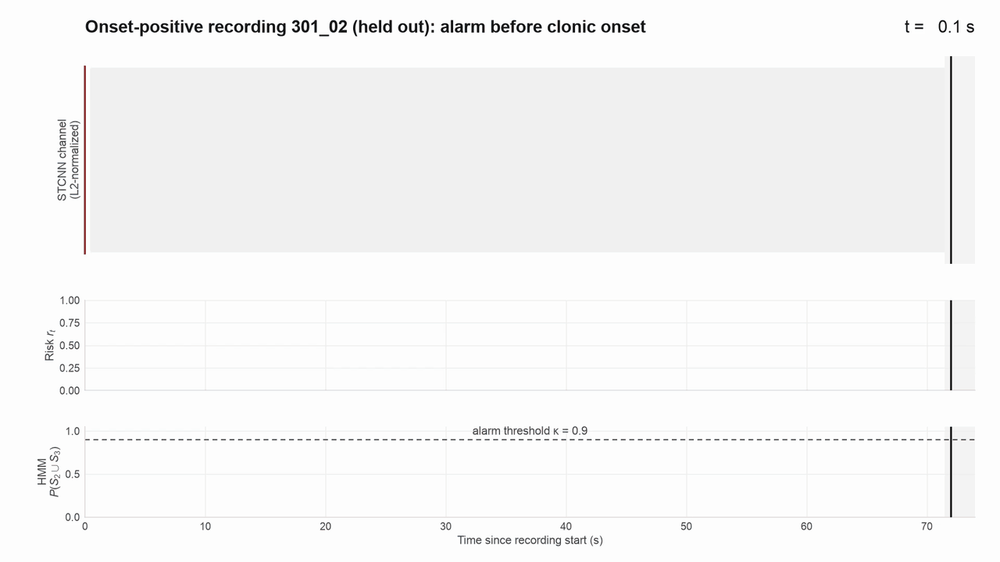
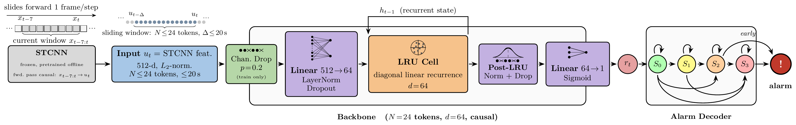

<h1 align="center">SOTERIA: Video-based Seizure Prediction</h1>

<!-- Badges -->
<p align="center">
  <!--<a href="http://www.iciibms.org/"></a>-->
  <!--<a href="https://arxiv.org/abs/YOUR_PAPER_ID"></a>-->
  <a href="https://gavin-ho1.github.io/soteria/paper.pdf"></a>
  
  
  <a href="LICENSE"></a>
</p>

This is the official implementation of SOTERIA, accepted at ICIIBMS 2026.

<p align="center">
  <br>
  <sub><em>Causal replay of a held-out recording of video features and risk stream (3× speed)</em></sub>
</p>

Most video-based seizure work targets detection: retrospectively judging whether a recorded segment contains a seizure. SOTERIA is a strictly causal video-based system that instead targets ***prediction***: while a seizure is in progress, it estimates whether the seizure will reach clonic onset before that onset is visible, using only the video seen so far. Every prediction at time $t$ is a function of observations up to $t$ only, enforced by the following causal contract:

- Each frozen feature is timestamped at its *last* source frame.
- Onset-positive recordings are cut 0.5 s before the annotated onset.
- Each rolling window contains only features available at the decision time.
- The LRU and the HMM recurse strictly forward.
- The decision clock advances independently of the eventual outcome.

SOTERIA combines frozen spatiotemporal appearance embeddings  with a causal Linear Recurrent Unit (LRU) backbone and a forward-only hidden Markov model (HMM) alarm decoder that turns a noisy per-token risk stream into a single alarm decision. Evaluated on patient-disjoint 10-fold cross-validation over 15 seeds (210 recordings, 67 patients), SOTERIA anticipates clonic onset in 83.5% of onset-positive recordings, with a median 29-second warning among alarmed positives. Its mean rolling peak-risk ROC-AUC of 0.759 is the highest of the five backbones compared (LRU, causal Transformer, TCN, LSTM, and GRU) under the same training stack.

<p align="center">
  <br>
  <sub><em>SOTERIA pipeline</em></sub>
</p>

## Getting Started

This repository contains the model, training, alarm-decoding, and evaluation code used in the paper.

SOTERIA requires Python 3.10+. A virtual environment is recommended.
Here is a quick start:

```sh
git clone https://github.com/gavin-ho1/soteria.git
cd soteria
python3 -m venv .venv
source .venv/bin/activate
pip install -r requirements.txt
```

Unit tests cover the DeLong test, rolling evaluation, and the ablation/pre-onset contracts used to produce the paper's statistics, and can be run with:

```sh
python -m pytest tests/
```

### Dataset

The GESTURES feature release can be downloaded from the [UCL Research Data Repository](https://doi.org/10.5522/04/14781771) and unzipped anywhere. Its `features_fpc_8_fps_15/` folder and `seizures.csv` should then be copied, moved, or symlinked into `data/dataset/`:

```text
data/dataset/
├── features_fpc_8_fps_15/
└── seizures.csv
```

Or download and extract it in one step:

```sh
mkdir -p data/dataset
curl -L -o data/dataset.zip https://ndownloader.figshare.com/files/28668096
unzip -q data/dataset.zip 'features_fpc_8_fps_15/*' seizures.csv -d data/dataset
rm data/dataset.zip
```

The first training run (step 1) builds a feature cache at `data/cache/clean_features_v1.pt` from the per-snippet `.pth` files. This is slow and happens only once; however, the replay and window-density commands will also build it if it is missing.

### Reproducing the Paper

The commands below reproduce the paper's results.

#### 1. Train

Trains every paper condition (10 folds × 15 seeds) and saves one checkpoint per fold at `results/paper/checkpoints/<condition>/seed_<seed>/fold_<fold>.pt` (`fold_00.pt` to `fold_09.pt`).

```sh
python streaming_predictor/ablation_study.py --n-seeds 15 --device cpu \
  --seed-list 12811957 1661938183 1697828733 1344571277 320942036 1508945547 2004173725 1694056806 1456124910 1604011579 1814110808 1871455221 1205112118 198655547 1904331482 \
  --conditions default gru lstm tcn transformer gru_pure lstm_pure \
    bare +chan_drop +hazard +alarm_loss +focal +groupdro +margin \
  --save-checkpoints results/paper/checkpoints \
  --output results/paper/train.json
```

#### 2. Rolling Replay

The default model is replayed under every decoder. This one replay provides Table I, the LRU (full) row of Table II, the CVaR and "+ HMM decoder (full)" rows of Table IV, and Table VI in the paper.

```sh
python streaming_predictor/run_rolling_evaluation.py \
  --checkpoint-root results/paper/checkpoints/default \
  --alarm-modes threshold hmm4_early_skip_ssem hmm4_early_ssem hmm4_early \
    hmm4_early_full_ssem hmm4_early_skip_regressive_ssem \
    hmm4_skip_ssem hmm4_ssem hmm \
  --cadence-sec 1.0 --device cpu \
  --output results/paper/worker_posthoc/decoder/default_all_modes.json
```

The remaining conditions (below) are replayed the same way, which is needed for the rest of Tables II and IV.

<details>
<summary>Objective build-up conditions (Table IV)</summary>

The objective build-up conditions (the remaining rows of Table IV; `bare` is also the LRU row of the Table II BCE-only block):

```sh
for c in bare +chan_drop +hazard +alarm_loss +focal +groupdro +margin; do
  python streaming_predictor/run_rolling_evaluation.py \
    --checkpoint-root results/paper/checkpoints/$c --alarm-modes threshold \
    --cadence-sec 1.0 --device cpu \
    --output results/paper/worker_posthoc/objective/$c.json
done
```

</details>

<details>
<summary>Comparison backbones (Table II, upper block)</summary>

The comparison backbones (Table II, upper block):

```sh
for c in gru lstm tcn transformer; do
  python streaming_predictor/run_rolling_evaluation.py \
    --checkpoint-root results/paper/checkpoints/$c \
    --alarm-modes hmm4_early_ssem hmm4_early_skip_ssem \
    --cadence-sec 1.0 --device cpu \
    --output results/paper/worker_arch/rolling/$c.json
done
```

</details>

<details>
<summary>BCE-only GRU and LSTM (Table II, lower block)</summary>

The BCE-only GRU and LSTM (Table II, lower block):

```sh
for c in gru_pure lstm_pure; do
  python streaming_predictor/run_rolling_evaluation.py \
    --checkpoint-root results/paper/checkpoints/$c --alarm-modes threshold \
    --cadence-sec 1.0 --device cpu \
    --output results/paper/worker_misc/rolling/$c.json
done
```

</details>

#### 3. Statistics

Produces Tables I–VI, Fig. 2, and the decoder operating-point-vs-curve check in `results/paper/paper_analysis/`:

```sh
python -m streaming_predictor.analyze_operating_point_vs_curve \
  --result-root results/paper --out-dir results/paper/paper_analysis
python -m streaming_predictor.analyze_rolling_paper_results \
  --result-root results/paper --out-dir results/paper/paper_analysis \
  --cluster-boot 10000 --bootstrap-seed 20260817
```

The warm-up and short-history statistics quoted in the paper's Limitations need only the data, not trained models:

```sh
python -m streaming_predictor.analyze_window_density \
  --output results/paper/window_density.json
```

The rolling-replay outputs behind the published tables are committed under `streaming_predictor/results/postaudit_rolling_only_20260817/` in the same layout, together with the statistics step 3 produced from them (`paper_analysis_complete_20260818/`). Result directories are gitignored by default; this run was explicitly added so its results can be inspected.

The paper's statistics can be checked without retraining by running step 3 with `--result-root streaming_predictor/results/postaudit_rolling_only_20260817` and a fresh `--out-dir`; this takes a few minutes and reproduces the committed CSVs exactly. The [seed manifest](streaming_predictor/results/postaudit_rolling_only_20260817/reproduction_seeds.json) records the 15 condition seeds, the per-fold seed rules, and the patient-bootstrap seed.

> [!NOTE]
> A full retrain will be close to, but not numerically identical to, the published tables because CPU and dependency versions can change floating-point results, so a rerun can be compared against the paper's confidence intervals, not its exact digits.

### Benchmarks

Optional latency benchmarks are in `benchmarks/`. Their extra dependencies can be installed with:

```sh
pip install -r benchmarks/requirements.txt
```

`bench_decode.py` also requires [`ffmpeg`](https://ffmpeg.org/download.html) built with `libx265` on `PATH`.

## Repository Layout

```text
soteria/
├── common/  # data loading and CV folds
│   ├── data.py
│   ├── splits.py
│   └── paths.py
├── streaming_predictor/  # model, training, and evaluation
│   ├── model.py
│   ├── config.py
│   ├── data.py
│   ├── train.py
│   ├── evaluate.py
│   ├── rolling_evaluation.py
│   ├── ablation_study.py
│   ├── run_rolling_evaluation.py
│   ├── analyze_rolling_paper_results.py
│   ├── analyze_operating_point_vs_curve.py
│   ├── analyze_window_density.py
│   ├── delong.py
│   └── results/
│       └── postaudit_rolling_only_20260817/  # committed paper results
├── tests/
├── benchmarks/
└── img/
```

## Citation

If this work helps your research, please cite:

```bibtex
@misc{ho2026soteria,
  title         = {SOTERIA: Video-based Seizure Prediction},
  author        = {Ho, Gavin},
  year          = {2026}
}
```
